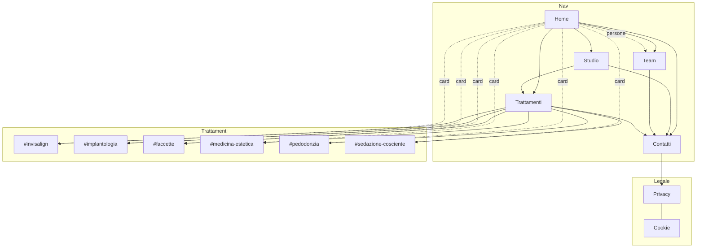

# Struttura del sito e link interni (skill site-structure-optimizer)

**Tipo di sito:** studio medico locale (dentista), 5 pagine + 2 pagine legali.
**Modalità:** architettura e collegamenti. Il numero di pagine e i testi restano quelli concordati: ho ottimizzato solo navigazione, link e azioni (CTA).
**Etichette delle metriche:** *Misurato* = scansione del sito attuale (5 pagine) · *Stimato* = valutazione del modello.

## Gerarchia (URL invariati: nessun redirect di migrazione serve)

```
/                      L0  Home
├── /trattamenti/      L1  18 ancore: #invisalign #ortodonzia #faccette #medicina-estetica #implantologia
│                          #chirurgia-orale #gnatologia #parodontologia #laser #conservativa-estetica
│                          #odontoiatria-conservativa #protesi #endodonzia #sbiancamento #pedodonzia
│                          #sedazione-cosciente #microscopia #igiene-orale
├── /team/             L1  ancore per medico: #francesco-paolo-giancaspro #silvia-giancaspro
│                          #federico-giancaspro #giuseppe-zarra #pasquale-correra
├── /studio/           L1  #sala-attesa #zona-clinica #area-tecnica #parcheggio
├── /contatti/         L1
├── /privacy-policy/   L1  (prima era un link "#" non funzionante: Misurato)
└── /cookie-policy/    L1  (prima era un link "#" non funzionante: Misurato)
```

Profondità massima: 1 clic, e 2 per le ancore. Nessuna pagina importante sta oltre i 3 clic.

## Problemi trovati sul sito attuale (Misurato)
| # | Problema | Correzione |
|---|---|---|
| 1 | I link Privacy/Cookie del footer puntavano a `#`: pagine orfane/inesistenti | Create `/privacy-policy/` e `/cookie-policy/`, collegate da footer, banner e form |
| 2 | "Scopri lo Studio" in Home puntava a un'ancora (`#lostudio`) invece che a `/studio/` | Ora punta a `/studio/` |
| 3 | Le card trattamenti in Home non avevano link | Ogni card porta all'ancora del trattamento in `/trattamenti/` |
| 4 | I medici in Home non portavano alla scheda | Le card portano a `/team/#medico` |
| 5 | Il link Instagram in Trattamenti era rotto (`…giancaspro/ç`) e c'erano due handle diversi | Un solo handle in `config.json` |
| 6 | La CTA della Home ("Prenota consulenza") portava solo a WhatsApp | Modale con modulo, WhatsApp e chiamata, raggiungibile da ogni pagina |
| 7 | 18 trattamenti in un'unica pagina lunga senza indice | Indice fisso con evidenziazione della sezione (barra a chip su mobile) |

## Navigazione
- **Header:** logo → Home, poi 5 voci, telefono e il pulsante "Prenota Consulenza" all'estrema destra (menzionato due volte: header e modale).
- **Mobile:** menu a schermo intero e barra fissa in basso (Chiama · WhatsApp · Prenota) dopo la hero.
- **Hero della Home:** accesso immediato a Prenota, Trattamenti (4 ancore in evidenza), Come trovarci (Maps) e Telefono/WhatsApp.
- **Breadcrumb** su tutte le pagine interne.
- **Footer:** Navigazione, Contatti, Privacy, Cookie, Preferenze cookie.

## Mappa (hub/spoke)



Nessuna pagina orfana e nessuna isola di link.

## Punteggio struttura
- **Prima:** 70/100 (Stimato): −10 per 2 pagine legali orfane o inesistenti, −10 per link interni rotti o assenti verso Studio e Trattamenti, −10 per l'handle Instagram incoerente.
- **Dopo:** 95/100 (Stimato). Il −5 residuo dipende dal fatto che i 18 trattamenti stanno in un'unica pagina. Se un giorno si potranno aggiungere pagine, i primi candidati per pagine dedicate sono Invisalign® e Implantologia.

## Riepilogo
- Struttura piatta, URL invariati, nessun redirect obbligatorio. Il `.htaccess` reindirizza comunque i vecchi URL di WordPress (`/feed/`, `/wp-*`).
- Dati strutturati Schema.org `Dentist` su tutte le pagine, più `sitemap.xml` e `robots.txt`.
- Prossimo passo consigliato: controllo SEO on-page su titoli e meta description dopo la pubblicazione.
